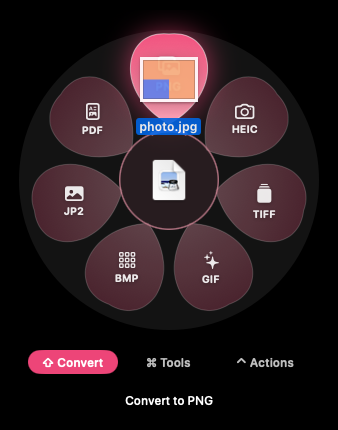
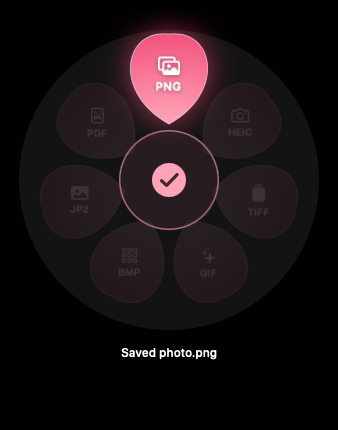
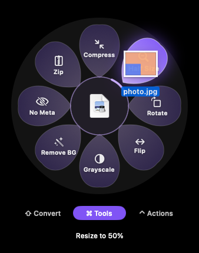
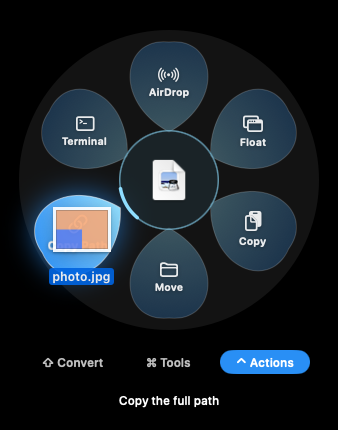

# Bloom

[](LICENSE)

**Convert, shrink or share a file without opening anything.**

Drag a file, tap a key, and a flower of options blooms around your cursor. Drop the file on a petal and it's done: converted, shrunk, rotated, zipped or AirDropped.

<p align="center"></p>

No app to launch, no Export dialog, no website to upload to. Bloom lives in your menu bar, works on whatever you're already dragging, never touches the network and needs no Accessibility access.

## Three moves

1. **Drag** a file from Finder, the Desktop or anywhere else you can drag one.
2. **Tap a key** once the file is moving. A flower opens under your cursor. Press the key after you start dragging, not before: ⌃ held while you click makes a right-click.
3. **Drop it on a petal.** A ✓ and a pop, and the result is saved in the same folder as the original.

<p align="center">
  
  
</p>

Each key opens a different flower, and every petal on it works on the file you're holding:

| Tap | Flower | What's on it |
|---|---|---|
| **⇧ Shift** | **Convert** (pink) | Every format this file can become: HEIC to JPG, video to GIF, DOCX to PDF and more |
| **⌘ Command** | **Tools** (violet) | Compress, Half Size, Rotate, Flip, Remove BG, No Meta, Merge PDF, Zip and more |
| **⌃ Control** | **Actions** (blue) | AirDrop, Float on screen, Copy, Move, Copy Path, open in Terminal |

<p align="center">
  
  
</p>

Let go of the key whenever you like; the flower stays until you drop. Changed your mind mid-drag?

- **Switch flowers:** tap another key, or slide over the **⇧ Convert**, **⌘ Tools** and **⌃ Actions** tabs under the flower.
- **Cancel:** let go in the center.
- **Drop as usual:** let go away from the flower.

## Things you'll do with it

- Turn an iPhone **HEIC** into a **JPG** you can email: ⇧, then drop on JPG.
- Shrink a **screen recording** before you share it: ⌘, rest on Compress, then pick a size.
- Make a **GIF** from the first minute of a clip: ⇧, then GIF.
- Pull the **soundtrack** out of a video: ⇧, then M4A.
- Cut the **background** out of a product photo: ⌘, then Remove BG (macOS 14 or later).
- Strip **location data** from a photo before you post it: ⌘, then No Meta.
- Combine a pile of scans into **one PDF**: drag them together, ⌘, then Merge PDF.
- Turn a **Word document** into a **PDF**: ⇧, then PDF.
- Unpack a **.tar.gz**: ⌘, then Extract.
- Keep a file **floating on screen** to drag into an email later: ⌃, then Float.

Your original is never touched. Results get Finder-style names: `photo.jpg` becomes `photo.png` in the same folder, or `photo 2.png` if that name is taken.

## Install

Requires macOS 13 or later and Apple's Command Line Tools (the installer offers them if they're missing).

```bash
git clone https://github.com/s3anstanz/Bloom.git ~/Bloom
~/Bloom/scripts/install.sh
```

Bloom runs from the menu bar. Its flower icon opens while you drag a file, circles while Bloom works and fills its center when a result is saved. From that menu you can turn on **Open at Login**. To get the latest version:

```bash
~/Bloom/scripts/update.sh
```

## Every petal

When several files are dragged together, the flowers offer what works on all of them at once.

### ⇧ Convert

| Dragged file | Converts to |
|---|---|
| Images (JPG, PNG, HEIC, WebP, AVIF, TIFF, GIF, BMP, …) | JPG, PNG, HEIC, TIFF, GIF, BMP, JP2, PDF, plus WebP and AVIF where macOS can write them |
| PDF | PNG, JPG (one image per page), TXT |
| Video (MOV, MP4, M4V) | MP4, MOV, M4V, GIF (first 60 s), M4A (the soundtrack, for videos that have one) |
| Audio (MP3, M4A, WAV, AIFF, FLAC, …) | M4A, WAV, AIFF |
| Documents (DOCX, DOC, RTF, ODT, HTML, TXT, MD) | PDF, DOCX, RTF, TXT, HTML, ODT |
| Subtitles (SRT, VTT) | SRT, VTT |

### ⌘ Tools

| Tool | Works on |
|---|---|
| Compress | Images, video, audio and PDFs ([sizes below](#compress)) |
| Half Size, Flip, Grayscale, No Meta (removes location and camera data) | Images |
| Rotate | Images and PDFs |
| Remove BG | Images, on macOS 14 or later |
| Mute | Video |
| Split | PDFs (one PDF per page) |
| Merge PDF | Two or more PDFs and/or images |
| Extract | ZIP and TAR archives, including compressed tarballs (.tar.gz, .tgz, .tar.bz2, .tbz, .tar.xz, .txz) |
| Zip | Anything, including folders, as long as everything dragged is in one folder |

#### Compress

Rest on Compress and three sizes bloom past it. Dropping on Compress itself makes Balanced.

| | Smaller | Balanced | Sharper |
|---|---|---|---|
| Images → JPG, up to | 1600 px | 2400 px | 3200 px |
| Video → MP4, up to | 540p | 720p | 1080p |
| Audio → AAC, per channel | 32 kbps | 64 kbps | 96 kbps |

Images with transparency stay PNG, so the see-through parts aren't filled in. PDFs have one size, from macOS's Reduce File Size filter. A result that isn't smaller than the original isn't kept.

### ⌃ Actions

| Action | What it does |
|---|---|
| **AirDrop** | Opens the AirDrop sheet. The first AirDrop from your Desktop, Documents or Downloads asks for access to that folder |
| **Float** | Keeps the file in a small card on screen. Drag its icon anywhere later to drop a copy, double-click to open, drag the card's edge to move it, ✕ to close |
| **Copy** | Puts the file on the clipboard, ready to paste with ⌘V |
| **Move** | Asks for a folder and moves the file there |
| **Copy Path** | Copies the full path |
| **Terminal** | Opens the file's folder in Terminal |

When an action can't work on your Mac, such as AirDrop on a Mac without it, its petal is dimmed and says why.

## Feedback

**Report a Problem…** and **Send Feedback…** in Bloom's menu open a GitHub issue in your browser, already filled in with your Bloom version, macOS version and Mac. After a drop fails, Report a Problem also fills in the petal, the file type and Bloom's error, never the file's name or folder. Read it, add what you like and submit it; nothing is sent before you do. You need a GitHub account.

## Permissions

- macOS may ask once per folder (Desktop, Documents or Downloads) before Bloom can use it, such as the first time you AirDrop a file from there.
- Bloom watches mouse drags and modifier keys only; it needs no Accessibility or Input Monitoring access.

## Develop

| Task | Command |
|---|---|
| Build, package and relaunch | `scripts/install.sh` |
| Run the tests | `swift test` |
| Format the code | `scripts/format.sh` |
| Check BloomCore stays offline | `scripts/check-no-network.sh` |
| Render each moment of the flower as a GIF | `swift run Bloom --preview build/preview` |
| Run what CI will run for your changes | `scripts/check.sh` |
| Play the end-to-end journeys | `scripts/e2e.sh` |
| Drop a sample of every kind of file on every petal | `scripts/e2e.sh --matrix` |

- `Sources/BloomCore`: everything about files: which petals a file gets, every conversion and tool, key taps, petal hit-testing and what a problem report says.
- `Sources/Bloom`: the menu-bar app, drag detection, the flower, Float cards and the Actions petals.
- `Sources/BloomRender`: a helper bundled inside Bloom.app that renders documents to PDF, keeping the app responsive during long documents.
- `Sources/BloomE2E`: end-to-end journeys that drag files out of Finder into the real app and check what it saves, and the petal matrix.
- `Sources/BloomFixtures`: generates the sample photos, PDFs, videos, audio, documents, subtitles and archives the tests and journeys use, and checks that a result opens as its type.
- `Tests/BloomCoreTests`: runs every petal on generated sample files and checks each result opens, plus catalog, naming, subtitle, key-tap and petal-geometry tests.

GitHub Actions tests every pull request on real Macs, running only the tests its files need. How CI chooses them, and how to release: [CONTRIBUTING.md](CONTRIBUTING.md).

## Privacy and security

Bloom reads the files you drop on it and writes results to the same folder. It has no network code, no analytics and no third-party dependencies, and CI fails if networking code appears in BloomCore. Feedback goes through your browser, only when you submit it. Bloom notes what happens to each drag (the flower opening, a drop arriving or being refused) in your Mac's own log, never a file's name or folder; search Console for `com.westfalllabs.bloom` to read it. To report a security problem, see [SECURITY.md](SECURITY.md).

## License

[MIT](LICENSE) © 2026 Westfall Labs LLC
